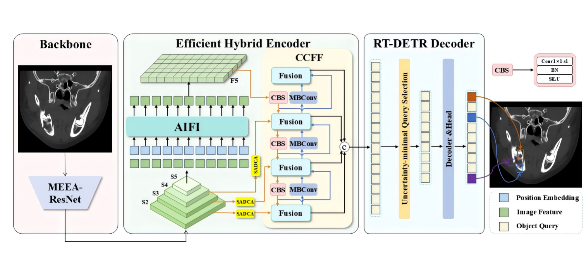
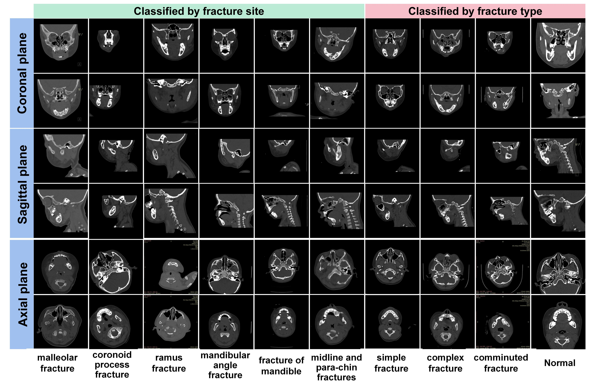
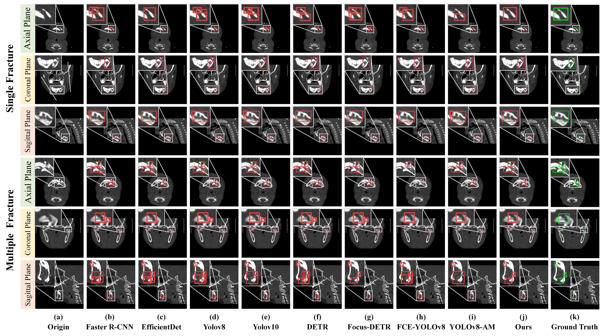
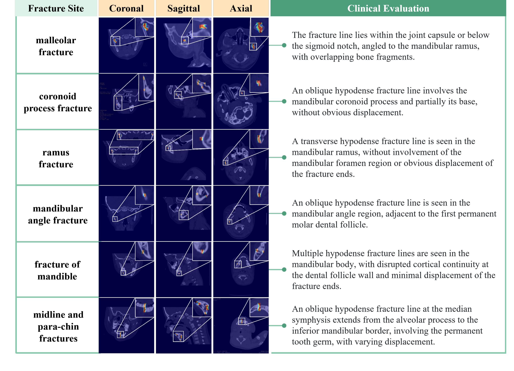
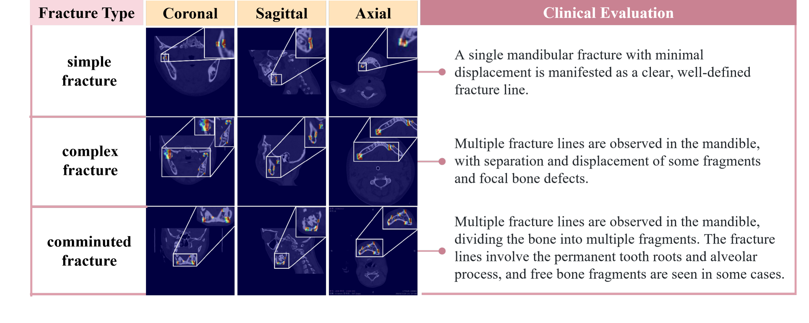

This code is a **pytorch** implementation of our paper "**PMF-DETR: A Pediatric Mandible Fracture Detector Based on Improved Real-Time DEtection TRansformer for Low-Dose Computed Tomography**".



**Fig. 1.** Overview of the **PMF-DETR** architecture.

## 🧑🏻‍🏫 Background

Low-dose pediatric CT can contain weak fracture boundaries, reduced local contrast and elongated fracture patterns. PMF-DETR combines edge-sensitive early features, content-dependent aggregation and directional convolutions within an end-to-end detection pipeline.

## 🔍 Current Challenges

- Subtle boundaries can be lost during early feature extraction.
- Similar foreground and background intensities make local aggregation difficult.
- Long, thin fractures can occur at different orientations.
- Thin bounding boxes make localization sensitive to small coordinate errors.

## 🌟 Main Components

| Component | Implemented behavior |
| --- | --- | --- |
| MEEA | Gabor/Sobel filter banks at dilations 1, 2 and 5; learned pointwise fusion and a sigmoid feature gate |
| SADCA | Per-image foreground/background dynamic depthwise kernels, spatial blending, channel and spatial attention
| MBConv | Horizontal, vertical and two diagonal-initialized convolution branches; concatenation and fusion |
| Localization | Focaler-GIoU with standard RT-DETR Hungarian matching, L1 and classification terms |
| Detector | ResNet-18, four-scale feature fusion, P3/P4/P5 deformable decoder, auxiliary and denoising supervision |

## ⚙️ Prerequisites

- Python **3.10 or newer**; verified with Python 3.12.
- PyTorch **2.5.1**; CPU supports functional tests, and a CUDA GPU is recommended for full training.
- Pre-windowed 8-bit 2-D images and YOLO bounding-box labels.

The manuscript reports Python 3.8 / PyTorch 2.0.0+cu118 / RTX 4090. This cleaned release uses the separately documented environment above. CUDA training, CUDA AMP and the paper's reported 22 FPS were not measured in the available CPU environment.

## 🌵 Installation

Run the commands from the repository root:

```bash
python -m venv .venv
source .venv/bin/activate
# Windows PowerShell: .venv\Scripts\Activate.ps1

# Select one PyTorch build. Example for CUDA 11.8:
python -m pip install torch==2.5.1 --index-url https://download.pytorch.org/whl/cu118

# CPU alternative:
# python -m pip install torch==2.5.1 --index-url https://download.pytorch.org/whl/cpu

python -m pip install -r requirements.txt
python -m pip install --no-deps -e .
```

Other supported PyTorch 2.5.1 builds are listed in the [official installation matrix](https://pytorch.org/get-started/previous-versions/#v251). The core dependencies are PyTorch, NumPy, SciPy, Pillow and PyYAML. Tests use Python's built-in `unittest`.

## 🧪 Implementation Details

The main configuration is [`configs/pmf_detr_r18.yaml`](configs/pmf_detr_r18.yaml).

| Setting | Default in this release |
| --- | --- |
| Backbone | ResNet-18, three-convolution stem, two BasicBlocks per stage |
| Backbone feature strides | 4, 8, 16, 32 |
| Fusion / decoder | Four-scale fusion; three decoder inputs at strides 8, 16, 32 |
| Hidden dimension / queries / decoder layers | 256 / 300 / 3 |
| Input size / batch size / epochs | 640 / 4 / 300 |
| Optimizer | AdamW |
| Main / backbone learning rate | `1e-4` / `1e-5` |
| Weight decay / gradient clipping | `1e-4` / `0.1` |
| Scheduler | Three warmup epochs, then cosine decay |
| Classification / L1 / localization weights | 1 / 5 / 2 |
| Focaler interval | `[0.0, 0.95]` |
| Data transformation | RGB conversion, square bilinear resize, divide by 255; training horizontal flip probability 0.5 |

## 📦 Datasets

### PMF

Prepare and train each plane using the corresponding dataset configuration:

- `configs/datasets/pmf_axial.yaml`
- `configs/datasets/pmf_coronal.yaml`
- `configs/datasets/pmf_sagittal.yaml`



**Fig. 2.** Examples of fracture and normal CT images from the pediatric mandible fracture dataset, organized by anatomical plane, fracture site and fracture type.

### Directory and label format

Example for the axial plane:

| Images | Matching labels |
| --- | --- |
| `data/pmf/axial/images/train/case_001.png` | `data/pmf/axial/labels/train/case_001.txt` |
| `data/pmf/axial/images/val/case_002.png` | `data/pmf/axial/labels/val/case_002.txt` |
| `data/pmf/axial/images/test/case_003.png` | `data/pmf/axial/labels/test/case_003.txt` |

Each label row is `class_id center_x center_y width height`, with coordinates normalized to `[0,1]`. The default task has one class, `fracture`, with ID `0`:

```text
0 0.421875 0.503125 0.106250 0.056250
```

Use an **existing empty `.txt` file for a verified negative image**. Missing labels are errors, preventing accidentally unannotated slices from silently becoming negatives. Images must be pre-windowed 8-bit files; raw DICOM/NIfTI and high-bit-depth CT intensities require a separately defined conversion protocol.

In a dataset YAML, `path` is resolved relative to that YAML file. Split directories and entries in image-list `.txt` files are resolved relative to `path`. Absolute paths are also accepted. For example:

```yaml
path: ../../data/pmf/axial
train: images/train
val: images/val
test: images/test
names: [fracture]
```

Check the dataset before a long run:

```bash
python tools/check_dataset.py --data configs/datasets/pmf_axial.yaml
```

For patient leakage checks, add `--patients data/pmf/axial/patients.csv`. The CSV must have `image,patient_id` columns, with image paths relative to the dataset root. The checker validates images, labels, class IDs, box bounds, image-path overlap and optional patient overlap.

### Patient-level split preparation

Use the original experiment split if it is available. To make a new patient-disjoint split:

```bash
python tools/split_dataset.py \
  --manifest data/pmf/axial/patients.csv \
  --root data/pmf/axial \
  --output data/pmf/axial/splits \
  --ratios 0.7 0.1 0.2 --seed 42
```

LabelImg/Pascal VOC exports can be converted with:

```bash
python tools/convert_voc.py --annotations path/to/Annotations \
  --output data/pmf/axial/labels/train --classes fracture
```

## 🍳 Training

```bash
python train.py \
  --config configs/pmf_detr_r18.yaml \
  --data configs/datasets/pmf_axial.yaml \
  --device cuda:0 --output runs/pmf_axial
```

Replace the dataset YAML to train coronal, sagittal or RibFrac models. The default implementation uses one CPU or one CUDA device. `--epochs`, `--batch-size`, `--workers`, `--imgsz`, `--seed`, `--lr` and `--backbone-lr` override their YAML values. `--amp` opts into CUDA mixed precision. `--threads 2` is useful for CPU checks. On Windows, start with `--workers 0`.

Resume in the original run directory:

```bash
python train.py --resume runs/pmf_axial/last.pt \
  --data configs/datasets/pmf_axial.yaml --device cuda:0
```

To start a new experiment from a compatible checkpoint instead:

```bash
python train.py --config configs/pmf_detr_r18.yaml \
  --data configs/datasets/pmf_axial.yaml \
  --weights runs/pmf_axial/best.pt --output runs/pmf_axial_finetune
```

## 🗃️ Checkpoints and Logs

| Output | Purpose |
| --- | --- |
| `last.pt` | Latest resumable state |
| `best.pt` | State with the highest validation AP50:95 |
| `config.yaml` | Effective experiment settings |
| `experiment.json` | Dataset, class order, environment and data signature |
| `history.json` | Per-epoch losses, learning rates and validation metrics |

## 📊 Evaluation

```bash
python val.py --checkpoint runs/pmf_axial/best.pt \
  --data configs/datasets/pmf_axial.yaml --split test \
  --device cuda:0 --conf 0.25 --score-threshold 0.001 \
  --output runs/pmf_axial/test_metrics.json
```

## 🖼️ Qualitative Results

Figures below present the paper's detection comparisons and heatmaps.

### Detection Comparison



**Fig. 3.** Qualitative comparison of nine detection methods, including representative CNN-based, YOLO, Transformer-based and fracture-specific methods, together with PMF-DETR. Single- and multiple-fracture examples are shown in axial, coronal and sagittal views. Predicted boxes are red; ground-truth boxes are green in the rightmost column.

### Heatmaps by Anatomical Site



**Fig. 4.** PMF-DETR heatmaps for representative pediatric mandibular fractures at six anatomical sites. The imaging columns show coronal, sagittal and axial views. White rectangles and connecting lines identify enlarged regions; the rightmost column contains the clinical interpretations.

### Heatmaps by Fracture Type



**Fig. 5.** PMF-DETR heatmaps grouped into simple, complex and comminuted fractures. Coronal, sagittal and axial views are accompanied by enlarged regions and the clinical interpretations.

## 🚅 Inference

```bash
python predict.py --checkpoint runs/pmf_axial/best.pt \
  --source path/to/images --device cuda:0 \
  --conf 0.25 --output runs/pmf_axial/predictions
```

For an explicitly measured model-only throughput report:

```bash
python tools/benchmark.py --checkpoint runs/pmf_axial/best.pt \
  --device cuda:0 --imgsz 640 --batch-size 1 \
  --warmup 10 --iterations 50 --output runs/pmf_axial/benchmark.json
```

## 🔬 Ablations

`configs/ablations/modules_ABC.yaml` enumerates all eight combinations, where **A=MEEA, B=SADCA, C=MBConv**. For example, `modules_100.yaml` enables MEEA alone and `modules_111.yaml` enables all three.

```bash
python train.py --config configs/ablations/modules_100.yaml \
  --data configs/datasets/pmf_axial.yaml --output runs/ablation_100
```

## ✅ Software Verification

```bash
python -m unittest discover -s tests -v

python tools/make_smoke_data.py --output data/smoke
python tools/check_dataset.py --data data/smoke/dataset.yaml --patients data/smoke/patients.csv
python train.py --config data/smoke/smoke_config.yaml --data data/smoke/dataset.yaml \
  --device cpu --threads 2 --output runs/smoke
python val.py --checkpoint runs/smoke/best.pt --data data/smoke/dataset.yaml \
  --split test --device cpu --workers 0 --threads 2 --output runs/smoke/test_metrics.json
python predict.py --checkpoint runs/smoke/best.pt --source data/smoke/images/test \
  --device cpu --threads 2 --output runs/smoke/predictions
```